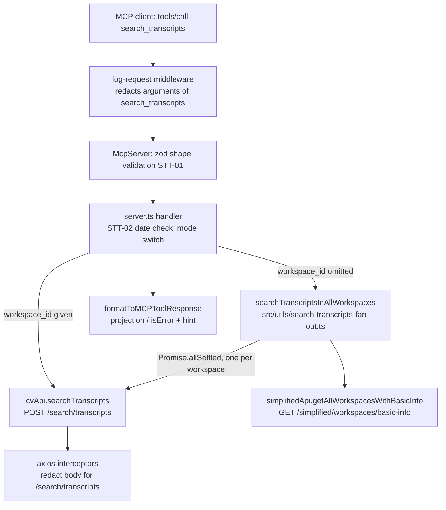

# Search Transcripts Tool Design

**Spec**: `.specs/features/search-transcripts/spec.md` (STT-01..27)
**Decisions**: `.specs/features/search-transcripts/context.md` (locked, not reopened here)
**Status**: Approved design pending Frederico's Execute OK. DD-1 decided 2026-11-03: **Option A**.

There is no `.specs/STATE.md` and no lessons store in this repo, so no project-level `AD-NNN` constraint applies.

---

## Decision DD-1 (decided 2026-11-03: Option A)

### DD-1: the ToolDoc the spec asks for does not fit the repo's tool-description budgets

The repo has two size guards on what every session pays in `tools/list`:

| Guard | Where | Limit | Today |
| --- | --- | --- | --- |
| Rendered description per tool | `tests/unit/docs/tool-docs.test.ts:13` `MAX_DESCRIPTION_CHARS` | 1,200 chars | largest existing tools fit |
| Whole `tools/list` payload | `tests/integration/mcp-protocol.test.ts:477` `MAX_WIRE_BYTES` | 72,000 bytes | **70,023 bytes** (42 tools, measured 2026-11-03) |
| One tool on the wire | `tests/integration/mcp-protocol.test.ts:478` `MAX_PER_TOOL_BYTES` | 4,000 bytes | max `search_message_ids` 3,323 |

A terse draft that states everything STT-19, STT-20 (a)-(h), STT-21, STT-22 and STT-23 require (draft in [ToolDoc](#tooldoc) below), plus the 9-param schema, measures:

| Measure | Value | Limit | Result |
| --- | --- | --- | --- |
| Rendered description | 2,309 chars | 1,200 | ❌ over by 1,109 |
| Rendered description without `recommendedFields` | 1,833 chars | 1,200 | ❌ over by 633 |
| Tool on the wire (schema + description + annotations) | 3,980 bytes | 4,000 | ✅ by 20 bytes |
| Tool on the wire without `recommendedFields` | ~3,500 bytes | 4,000 | ✅ |
| Whole payload after adding the tool | ~74,000 / ~73,500 bytes | 72,000 | ❌ |

(Measured with the repo's own `renderToolDoc` and `zod-to-json-schema`, the same path the SDK takes.)

So the spec's ToolDoc ACs and the repo's guards contradict each other. Options, all delivering the same tool:

| Option | Changes | Cost |
| --- | --- | --- |
| **A (recommended)** Drop `recommendedFields` (remove STT-22), keep all STT-20 prose; give `search_transcripts` its own description cap of 1,900 chars in `tool-docs.test.ts` and raise `MAX_WIRE_BYTES` to 75,000 with the measured numbers in the comment | Spec: remove STT-22. Tests: one per-tool override, one constant | ~3.5 KB (~950 tokens) more in every session's `tools/list` |
| B Keep the 1,200 cap; cut STT-20 to (a), (b), (h); drop STT-22 | Spec: shrink STT-20, remove STT-22. Tests: raise `MAX_WIRE_BYTES` only | Agent loses the paging, `scope_capped`, date-window, voice-memo and `get_message` hints (all still in cv-api's own docs, not in the agent's) |
| C Keep the spec as is; raise the cap for this tool to 2,400 and `MAX_WIRE_BYTES` to 75,000 | Tests only | ~4 KB more per session; `recommendedFields` keeps almost the whole payload (see below) |

Why `recommendedFields` is the part to drop: the heavy field of this response is `matched_chunk` (up to ~500 words per row), and the prose tells the agent to read it, so any valid projection keeps it. The projection can only strip `conversation_id`, `creator_id`, `creator_name`, `created_at`, `parent_message_id`, `workspace_id`, `best_score`, `empty_workspaces` — a few dozen bytes per row against ~3 KB of chunk. It costs ~480 chars of description on every session to save almost nothing per call. `response_fields` itself stays (STT-04, STT-13).

**Decided: Option A** (Frederico, 2026-11-03). STT-22 is removed and STT-18 now names both budget exceptions.

---

## Architecture Overview



Single mode is one call passed through. Fan-out lists workspaces, starts one search per workspace at once, waits for all to settle, and builds the grouped response from the settled results. Both modes end in `formatToMCPToolResponse`, so projection and error formatting are the same code as every other tool.

---

## Code Reuse Analysis

### Existing Components to Leverage

| Component | Location | How to Use |
| --- | --- | --- |
| `mutator` + `handleAxiosError` | `src/utils/axios-instance.ts` | Single request; errors arrive as `{statusCode, body:{error:{code,...}}}` with the codes STT-05/STT-15 name |
| Hand-rolled full-API pattern | `src/cv-api.ts` `searchMessageIds` | Copy for `searchTranscripts` (POST with `data`, like `searchMessagesByHeardStatus`) |
| `getAllWorkspacesWithBasicInfo` | `src/generated/carbon-voice-api.ts:801` | Workspace list for fan-out; returns `{id, name}[]`; cv-api dedupes `personal` (`simplified-workspace.service.ts:27-35`) |
| `formatToMCPToolResponse` + `projectResponse` | `src/utils/format-to-mcp-tool-response.ts`, `src/utils/project-response.ts` | Success with `responseFields`; error with `{isError, tool}` adds the `commonErrors` hint (`tool-error-hint.ts`) |
| Handler-built error envelope | `src/server.ts:487-497` (`INVALID_AUDIO_URL`) | Same shape for the STT-02 `BAD_REQUEST` |
| `responseFieldsShape` | `src/server.ts:135` | Spread into the input shape |
| Route skip list idiom | `src/utils/axios-instance.ts:58` `NOT_LOG_ROUTES` | Same idiom for a body-redaction route list |
| ToolDoc registry + renderer | `src/docs/tool-docs.ts`, `src/docs/render-tool-doc.ts`, `src/docs/tool-names.ts` | New entry + name |
| `search` zod module | `src/schemas/search.ts` | New `searchTranscriptsParams` beside the other full-API search schemas |

### Integration Points

| System | Integration Method |
| --- | --- |
| cv-api `POST /search/transcripts` (PR #571) | `cvApi.searchTranscripts(body, authOptions)`; body = validated args minus `response_fields` |
| cv-api `GET /simplified/workspaces/basic-info` | Existing generated client, injected into the fan-out function |
| Shared logging (winston) | Three content-free changes: middleware, axios interceptors, handler log (see Privacy) |

---

## Components

### 1. Input schema — `searchTranscriptsParams`

- **Purpose**: STT-01 bounds, enforced by the SDK before the handler runs.
- **Location**: `src/schemas/search.ts` (exported through `src/schemas/index.ts`).
- **Interface**:

```ts
// Same rule as cv-api TranscriptSearchRequest.ts ISO_OFFSET_SUFFIX.
export const ISO_OFFSET_SUFFIX = /(Z|[+-]\d{2}:\d{2})$/;

export const searchTranscriptsParams = z.object({
  query: z.string().max(500).regex(/\S/, 'query must not be blank'),
  workspace_id: z.string().min(1).optional(),
  conversation_ids: z.array(z.string().min(1)).max(50).optional(),
  creator_ids: z.array(z.string().min(1)).max(50).optional(),
  exclude_message_ids: z.array(z.string().min(1)).max(500).optional(),
  start_date: z.string().datetime({ offset: true }).regex(ISO_OFFSET_SUFFIX).optional(),
  end_date: z.string().datetime({ offset: true }).regex(ISO_OFFSET_SUFFIX).optional(),
  limit: z.number().int().min(1).max(50).optional(),
}); // each field gets a terse .describe() (integration test "documents every parameter")
export type SearchTranscriptsParams = z.infer<typeof searchTranscriptsParams>;
```

- **Verified (zod 3.25.58, 2026-11-03)**: `.datetime({offset:true})` alone ACCEPTS `+0300` and rejects `+03`, no-offset and `2026-02-30`; the extra `.regex(ISO_OFFSET_SUFFIX)` is what rejects `+0300`, as STT-01 requires.
- `limit` has NO zod default: single mode must send nothing (endpoint default 30, STT-04) and fan-out must send 10 (STT-07); a default in the schema would erase that difference.
- **Reuses**: `idList` style from the same file (not the helper itself: it allows empty strings, STT-01 forbids them).

### 2. API client — `cvApi.searchTranscripts`

- **Purpose**: one `POST /search/transcripts` (STT-03).
- **Location**: `src/cv-api.ts`.
- **Interface**: `searchTranscripts(body: TranscriptSearchBody, options?: AxiosRequestConfig): Promise<TranscriptSearchResponse>` → `mutator({ url: '/search/transcripts', method: 'POST', data: body }, options)`.
- `TranscriptSearchBody` = `SearchTranscriptsParams & { workspace_id: string }`.
- **Reuses**: `searchMessagesByHeardStatus` (POST + `data`).

### 3. Response types

- **Location**: `src/interfaces/transcript-search.interface.ts` (exported from `src/interfaces/index.ts`).
- Mirror of cv-api `TranscriptSearchResponse.ts` plus the grouped shape:

```ts
export interface TranscriptSearchResult {
  message_id: string; conversation_id: string | null; conversation_name: string | null;
  workspace_id: string; creator_id: string; creator_name: string | null;
  created_at: string; parent_message_id: string | null; score: number; matched_chunk: string;
}
export interface TranscriptSearchResponse { results: TranscriptSearchResult[]; scope_capped: boolean }

export interface TranscriptSearchGroup {
  workspace_id: string; workspace_name: string; result_count: number;
  best_score: number; scope_capped: boolean; results: TranscriptSearchResult[];
}
export interface TranscriptSearchFanOutResponse {
  needs_workspace_choice: boolean;
  workspaces: TranscriptSearchGroup[];
  empty_workspaces: { workspace_id: string; workspace_name: string }[];
  skipped_workspaces: { workspace_id: string; workspace_name: string; reason: string }[];
}
```

### 4. Fan-out — `searchTranscriptsInAllWorkspaces`

- **Purpose**: STT-06..17 and the STT-27 summary line.
- **Location**: `src/utils/search-transcripts-fan-out.ts` (exported from `src/utils/index.ts`).
- **Interface**:

```ts
export const FAN_OUT_DEFAULT_LIMIT = 10;

export interface FanOutDeps {
  listWorkspaces: () => Promise<{ id: string; name: string }[]>;
  search: (body: TranscriptSearchBody) => Promise<TranscriptSearchResponse>;
}

/** Resolves the grouped response, or rejects with the original error object
 *  of the basic-info call (STT-08) or of the chosen failed search (STT-16). */
export async function searchTranscriptsInAllWorkspaces(
  args: Omit<SearchTranscriptsParams, 'workspace_id'>,
  deps: FanOutDeps,
): Promise<TranscriptSearchFanOutResponse>;

/** status + code of a thrown handleAxiosError envelope; never the message or details. */
export function describeFailure(error: unknown): { status?: number; code: string };
```

- **Why injected deps, not imports**: `src/cv-api.ts` imports `./utils`; a utils module importing `../cv-api` would be a cycle. Two function params also let the unit test drive it with plain fakes (pending promises for STT-06, 403/429/503 envelopes for STT-14..17) with no module mocks. The handler passes `() => simplifiedApi.getAllWorkspacesWithBasicInfo(auth)` and `(b) => cvApi.searchTranscripts(b, auth)`.
- Imports `logger` from `./logger` directly (not the barrel) to avoid the same cycle.
- **Algorithm**:
  1. `workspaces = await deps.listWorkspaces()` — a rejection propagates unchanged (STT-08), so no search starts.
  2. `settled = await Promise.allSettled(workspaces.map(w => deps.search({ ...args, workspace_id: w.id, limit: args.limit ?? FAN_OUT_DEFAULT_LIMIT })))` — `map` starts every call before any is awaited (STT-06, STT-07).
  3. Classify each settled entry in `basic-info` order (table below).
  4. If no entry fulfilled and at least one non-403 rejection exists → reject with the first 429's original error if any, else the first non-403 rejection's original error (STT-16).
  5. Else build: groups for fulfilled with `results.length > 0` (`result_count = results.length`, `best_score = max(score)`, `results`/`scope_capped` unchanged), sorted by `best_score` descending (STT-09, STT-10); `empty_workspaces` for fulfilled with 0 rows (STT-12); `skipped_workspaces` for non-403 rejections (STT-15); `needs_workspace_choice = groups.length >= 2` (STT-11).
  6. If any rejection happened, write the STT-27 summary line (below) before resolving or rejecting.

| Settled entry | `describeFailure` | Goes to | Counts as |
| --- | --- | --- | --- |
| fulfilled, `results.length > 0` | — | `workspaces` | succeeded |
| fulfilled, `results.length === 0` | — | `empty_workspaces` | succeeded |
| rejected, `statusCode === 403` | `FORBIDDEN` | nowhere (STT-14) | forbidden |
| rejected, any other envelope | its `body.error.code` (`RATE_LIMITED`, `SERVER_ERROR`, `NETWORK_ERROR`, `BAD_REQUEST`, `NOT_FOUND`, …) | `skipped_workspaces[].reason` | skipped |
| rejected, no envelope (non-axios throw) | `UNKNOWN_ERROR` | `skipped_workspaces[].reason` | skipped |

### 5. Tool registration — `search_transcripts`

- **Location**: `src/server.ts`, at the END of the Search & Notifications block (after `list_inbox_notifications`), and appended last in `TOOL_NAMES`: `server.test.ts` pins registration order to `TOOL_NAMES` for prompt-cache stability, and appending keeps every existing tool's position (and the cached prefix up to it) unchanged.
- **Input shape**: `{ ...searchTranscriptsParams.shape, ...responseFieldsShape }`. Annotations `readOnlyHint: true, destructiveHint: false, openWorldHint: false` (STT-25).
- **Handler** (target ~35 lines):

```ts
async (input, { authInfo }) => {
  const { response_fields, ...args } = input;          // STT-03: never sent
  if (args.start_date && args.end_date &&
      Date.parse(args.start_date) >= Date.parse(args.end_date)) {          // STT-02
    return formatToMCPToolResponse(
      { statusCode: 400, body: { error: { code: 'BAD_REQUEST',
        message: 'start_date must be before end_date' } } },
      { isError: true, tool: 'search_transcripts' });
  }
  const auth = setCarbonVoiceAuthHeader(authInfo?.token);
  try {
    const { workspace_id, ...rest } = args;
    const data = workspace_id
      ? await cvApi.searchTranscripts({ ...rest, workspace_id }, auth)    // STT-03/04
      : await searchTranscriptsInAllWorkspaces(rest, {                    // STT-06..17
          listWorkspaces: () => simplifiedApi.getAllWorkspacesWithBasicInfo(auth),
          search: (body) => cvApi.searchTranscripts(body, auth),
        });
    return formatToMCPToolResponse(data, { responseFields: response_fields }); // STT-04/13
  } catch (error) {
    // Metadata only: `args` holds the query and `error.body.error.details`
    // can hold a cv-api 400 that echoes it (STT-26 point a).
    logger.error('Error searching transcripts', {
      tool: 'search_transcripts', ...describeFailure(error) });            // STT-27
    return formatToMCPToolResponse(error, { isError: true, tool: 'search_transcripts' }); // STT-05/08/16
  }
}
```

- `Date.parse` is safe here: the schema already admitted only offset-terminated ISO strings, which `Date.parse` reads exactly.

---

## Privacy (STT-26, STT-27) — the riskiest part

### Where content reaches a log today

| # | Log line | Level | Content it carries for this tool | File |
| --- | --- | --- | --- | --- |
| a | tool handler `logger.error(..., { args, error })` (pattern of every tool) | error | `args.query`; `error.body.error.details.data` = cv-api 400 body with `value` / `target` = the query (`TranscriptSearchRequest.ts` header confirms the echo) | `src/server.ts` |
| b | `➡️ Making API request to` `data: config.data` | debug | the whole request body (query) | `src/utils/axios-instance.ts:252-261` |
| c | `❌ API request failed` `requestData`, `responseData`, `error.body.message` | error | body (query); 400 echo; the joined class-validator constraint text | `src/utils/axios-instance.ts:306-327` |
| d | `HTTP POST /mcp 200` `body: req.body` | info | `params.arguments.query` — also inside a JSON-RPC **batch array**, which SDK 1.15.1 accepts (`streamableHttp.js:309`) and which the middleware does not recognise as a tool call | `src/transports/http/middleware/log-request.middlware.ts:63-70` |

`matched_chunk` reaches a log only through (c) `responseData` on a failure body, (a) via `details`, or through `Error formatting response` (`format-to-mcp-tool-response.ts:93`, logs `data` only when `JSON.stringify` throws — not reachable for a JSON body parsed by axios; see Risks). Success responses are never logged with content: the response interceptor logs status/duration, the formatter logs size, `transport-send-diagnostics` logs ids and `hasError`.

### Chosen mechanism: three local, content-free changes keyed on this tool

| # | Change | Keyed on | Kept for STT-27 |
| --- | --- | --- | --- |
| a | The new handler logs `{ tool, status, code }` from `describeFailure(error)` — never `args`, never `error`. Other handlers untouched. | the new handler | tool name, HTTP status or code |
| b, c | `CONTENT_REDACTED_ROUTES = ['/search/transcripts']` next to `NOT_LOG_ROUTES`. For a matching `config.url` (exact match, as `NOT_LOG_ROUTES` does): request log `data: '[REDACTED]'`; error log drops `requestData`, `responseData` and `error.body.message`. | request URL | url, method, status, statusText, duration, `error.statusCode`, `error.body.code` |
| d | `REDACTED_ARGUMENT_TOOLS = new Set(['search_transcripts'])` in the middleware; the logged `body` is a COPY where a `tools/call` message for that tool has `params.arguments: '[REDACTED]'`; arrays are mapped element by element. `req.body` itself is never mutated (the SDK reads it). | JSON-RPC `params.name` | method, url, statusCode, duration, `TOOL_CALL_HTTP_COMPLETE.toolName` |

Exact-match URL keys mean `/search`, `/v3/search` and `/search/message-ids` keep logging exactly as today, and tool-name keys mean every other tool's arguments are logged exactly as today (spec D-3 stays a separate ticket).

### Alternatives rejected

| Alternative | Why not |
| --- | --- |
| Per-request flag on the axios config (`options.redactLog = true`) | Same size, but every call site must remember it; the URL list cannot be forgotten by a future second caller of the endpoint |
| A winston format that scrubs `query` / `matched_chunk` keys everywhere | Changes other tools' logs (out of scope); cannot catch the query inside an echoed constraint string or a `value` field |
| Stop logging request bodies for all tools | That is spec D-3, a separate ticket |

### STT-27 lines

- Single mode, or fan-out `basic-info` failure, or fan-out whole-call failure: the handler line `Error searching transcripts` `{ tool: 'search_transcripts', status, code }` (error level).
- Fan-out with any rejected search: one `SEARCH_TRANSCRIPTS_FAN_OUT` line `{ event, tool: 'search_transcripts', listed, succeeded, forbidden, skipped, failures: [{ workspace_id, status, code }] }` — `warn` when `skipped > 0`, `info` when every failure was a 403 (the `personal` 403 is expected on many calls and should not page anyone). Workspace ids, statuses and codes carry no user content.
- The axios error line (c) still fires per failed request with url and status, as for every tool.

---

## Error Handling Strategy

| Error scenario | Handling | Agent sees |
| --- | --- | --- |
| Arg outside STT-01 bounds | SDK zod rejects (`McpError InvalidParams`), handler never runs | protocol error naming the field |
| `start_date >= end_date` | handler, before any request (STT-02) | `isError` `BAD_REQUEST` + hint |
| Single mode, any HTTP/network failure | rethrown envelope (STT-05) | `isError` with `handleAxiosError` code + hint |
| Fan-out, `basic-info` fails | propagates before any search (STT-08) | `isError` with its code |
| Fan-out, some searches 403 | silent (STT-14) | absent from all lists |
| Fan-out, some searches fail non-403, ≥1 succeeds | `skipped_workspaces` (STT-15) | partial result + reason |
| Fan-out, none succeeds, ≥1 non-403 | first 429 else first non-403 rethrown (STT-16) | `isError`, `RATE_LIMITED` wins |
| Fan-out, every search 403 | success, all lists `[]` (STT-17) | empty grouped response |
| Fan-out, `basic-info` returns `[]` | same as STT-17 (no failure, nothing searched) | empty grouped response — **spec gap, see Risks** |

---

## ToolDoc

Draft (Option A, decided: no `recommendedFields`). Wording is checked against cv-api `SEARCH_TRANSCRIPTS_DESCRIPTION` and the DTO descriptions.

```ts
search_transcripts: {
  purpose: 'Find messages by meaning (semantic search over transcripts), with the part that matched.',
  whenToUse:
    '"Where did we discuss X?" without knowing the date or conversation. ' +
    'Omitting `workspace_id` searches every workspace, one request each out of 20/min: send it when known.', // STT-19, STT-20a
  whenNotToUse:
    '`search_message_ids` for notified, mentions/tags, labels; `list_messages` for plain history; ' +
    '`search_messages_by_heard_status` for unread. Exact names, URLs, ticket numbers may be missed.',      // STT-19
  prerequisites: [{ field: 'workspace_id', fromTool: 'get_workspaces_basic_info', fromField: 'id',
                    when: 'searching one workspace' }],                                                   // STT-21
  example: { query: 'launch date decision', workspace_id: 'ws-abc' },                                     // STT-24
  responseShape:
    'With `workspace_id`: `{results: [{message_id, conversation_id, conversation_name, score, matched_chunk, ...}], scope_capped}`. ' +
    'Without: `{needs_workspace_choice, workspaces: [{workspace_id, workspace_name, result_count, best_score, scope_capped, results}], empty_workspaces, skipped_workspaces: [{workspace_id, workspace_name, reason}]}`. ' +
    '`needs_workspace_choice` true: ask the user which workspace (name, count, best `matched_chunk`), then call again with its id. ' + // b
    '`skipped_workspaces` were NOT searched: tell the user; retry `RATE_LIMITED` ones later by id. ' +    // h
    'Next page: seen ids in `exclude_message_ids`. ' +                                                   // c
    '`scope_capped` true: narrow by `conversation_ids` or dates. ' +                                     // e
    'Window `[start_date, end_date)`, both with an offset. ' +                                          // f
    '`conversation_id: null` = your voice memo. ' +                                                      // d
    'Full message: `get_message` with `id` = `message_id`.',                                             // g — get_message's param is `id`
  commonErrors: [                                                                                         // STT-23
    { code: 'BAD_REQUEST', meaning: 'A bad argument', nextAction: 'fix the one the message names.' },
    { code: 'FORBIDDEN', meaning: 'Not a member of `workspace_id`', nextAction: 'pick one from `get_workspaces_basic_info`.' },
    { code: 'RATE_LIMITED', meaning: '20 searches/min used',
      nextAction: 'wait about a minute; without `workspace_id`, retry with a single `workspace_id`.' },
    { code: 'SERVER_ERROR', meaning: 'Search is down', nextAction: 'retry later and tell the user.' },
  ],
}
```

- `whenNotToUse` makes `search_transcripts` an overlapping tool: add `['search_transcripts', 'search_message_ids']` to the `PAIRS` table in `agent-task-chain.test.ts`.
- The STT-24 example uses single mode, so the integration double is one `searchTranscripts` mock.
- Param descriptions (terse, wire cost): `query` "What to look for, in natural language (max 500 chars)."; `workspace_id` "Workspace to search. Omit to search all of yours."; dates "Inclusive lower / EXCLUSIVE upper bound, ISO 8601 with Z or ±HH:MM."; `limit` "Rows per workspace, 1-50. Default 30, or 10 per workspace when `workspace_id` is omitted."; id lists state their max.

---

## Test Plan per AC

| AC | Test file | Test |
| --- | --- | --- |
| STT-01 | `tests/unit/schemas/search-transcripts.test.ts` (new) + `server.test.ts` (registered shape is this schema's shape) | `searchTranscriptsParams.safeParse`: each bound in STT-01 rejected (missing/blank/501-char query, 51 ids, 501 excluded ids, `''` in each list, `+0300`, no-offset, `limit` 0/51/2.5, `workspace_id: ''`); valid `Z` and `-03:00` accepted |
| STT-01 (wire) | `tests/integration/mcp-protocol.test.ts` | calling with a no-offset date returns a protocol error and the `searchTranscripts` double was not called |
| STT-02 | `server.test.ts` | equal and reversed dates → `BAD_REQUEST` `isError`, `searchTranscripts` and `getAllWorkspacesWithBasicInfo` not called (both modes) |
| STT-03 | `tests/unit/cv-api.test.ts` | `searchTranscripts` calls `mutator({url:'/search/transcripts',method:'POST',data:body}, options)` |
| STT-03 | `server.test.ts` | with `workspace_id`: one `searchTranscripts` call, body = args unchanged, no `response_fields`, auth header from token, `getAllWorkspacesWithBasicInfo` not called; no `limit` key when not given |
| STT-04 | `server.test.ts` | resolved `{results, scope_capped}` passed to `formatToMCPToolResponse` with `{responseFields}` |
| STT-05 | `server.test.ts` | rejection → `formatToMCPToolResponse(error, {isError:true, tool:'search_transcripts'})`; add the tool to the "Error responses" table |
| STT-06 | `tests/unit/utils/search-transcripts-fan-out.test.ts` | 4 workspaces → 1 `listWorkspaces` + 4 `search` calls, each with its `workspace_id` and the same other args; all 4 issued while the first is still pending |
| STT-07 | fan-out test | `limit` absent → every body `limit: 10`; `limit: 25` → every body 25 |
| STT-08 | fan-out test + `server.test.ts` | `listWorkspaces` rejects → same error rethrown, `search` never called; handler returns its code |
| STT-09 | fan-out test | groups carry `workspace_id`, `workspace_name`, `result_count`, `best_score` (max), `scope_capped` and `results` unchanged |
| STT-10 | fan-out test | groups sorted by `best_score` desc regardless of `basic-info` order |
| STT-11 | fan-out test | 0, 1, 2 groups → false, false, true |
| STT-12 | fan-out test | 0-row workspace in `empty_workspaces`, not in `workspaces` |
| STT-13 | `mcp-protocol.test.ts` | fan-out over the real formatter with `response_fields` narrows the grouped payload |
| STT-14 | fan-out test | spec's Independent Test (A 2 rows, B 1, C 0, `personal` 403): `personal` in no list |
| STT-15 | fan-out test | B 429 → `skipped_workspaces` `RATE_LIMITED`; 503 → `SERVER_ERROR`; network → `NETWORK_ERROR`; non-envelope → `UNKNOWN_ERROR`; A still returned |
| STT-16 | fan-out test | all fail [503, 429] → rejects with the 429 error; [403, 503, 500] → the 503 (first non-403) |
| STT-17 | fan-out test | all 403 → `{false, [], [], []}` |
| STT-18 | `tests/unit/docs/tool-docs.test.ts`, `agent-task-chain.test.ts`, `server.test.ts` "Tool inventory" | existing table-driven tests cover the new entry once `TOOL_NAMES` and `TOOL_DOCS` have it |
| STT-19, STT-20 | `tool-docs.test.ts` (new `describe('search_transcripts doc')`) | rendered description contains each required tool name and each item (a)-(h) marker: `20/min`, `needs_workspace_choice`, `exclude_message_ids`, `conversation_id: null`, `scope_capped`, `[start_date, end_date)`, `offset`, `get_message`, `skipped_workspaces` |
| STT-21 | `tool-docs.test.ts` + `agent-task-chain.test.ts` | prerequisite `workspace_id ← get_workspaces_basic_info.id`; existing "names a real tool" tests |
| STT-22 | removed (DD-1) | — |
| STT-23 | `tool-docs.test.ts` | `commonErrors` codes = the four; `RATE_LIMITED` step mentions a minute and a single `workspace_id` |
| STT-24 | `mcp-protocol.test.ts` | existing example-key tests + a `callTool` with the ToolDoc example returning non-error |
| STT-25 | `mcp-protocol.test.ts` | existing annotation tests (tool absent from `OPEN_WORLD_TOOLS` / `DESTRUCTIVE_TOOLS` → read-only, closed) + `server.test.ts` registration check |
| STT-26 | `tests/unit/privacy/search-transcripts-log-sentinel.test.ts` | see below |
| STT-26 (d) | `tests/unit/transports/http/middleware/log-request.middleware.test.ts` | logged body has `arguments: '[REDACTED]'` for the tool (object and batch array); other tools' bodies unchanged; `req.body` not mutated |
| STT-26 (b, c) | `tests/unit/utils/axios-instance.test.ts` | other routes still log `data` / `requestData` / `responseData` (no change for other tools) |
| STT-27 | sentinel test + fan-out test | error lines carry `search_transcripts` and the status; fan-out summary line carries `listed/succeeded/forbidden/skipped` |

### Sentinel test (STT-26) design

- File `tests/unit/privacy/search-transcripts-log-sentinel.test.ts`.
- Sets `process.env.LOG_LEVEL = 'debug'` and loads the modules under `jest.isolateModules` (the global `tests/setup.ts` forces `error`, which would make a debug check vacuous), then asserts `logger.level === 'debug'`.
- Captures EVERY line with an in-memory winston transport at `debug` added to the real logger; each captured `info` is `JSON.stringify`-ed whole (message + meta).
- Real path, network faked at the edge: real `McpServer` + `Client` over `InMemoryTransport` (as `mcp-protocol.test.ts`), real `cv-api`, real `mutator` and interceptors; the network is a custom axios adapter set on the exported `customAxios.defaults.adapter`, keyed by URL.
- Sentinels: `QUERY = 'sentinel-query-<uuid>'`, `CHUNK = 'sentinel-chunk-<uuid>'`. The 200 body carries `CHUNK` in `matched_chunk`; the 400 body echoes `QUERY` in `value`, `target.query` AND a constraint string (worst case of `I18nValidationExceptionFilter`).
- Matrix: single mode × {200, 400-echo, 429, 503, network error}; fan-out × {all 200, mixed 200/403/429/503, all 503, `basic-info` 503}. Plus the middleware (d) driven with the same `tools/call` body (object and batch) through the real `logRequest` with a fake `res` that emits `finish`.
- Asserts: zero captured lines contain `QUERY` or `CHUNK`; AND at least one captured line per scenario contains `/search/transcripts` (or `search_transcripts`) and the expected status — so the test cannot pass by logging nothing.
- **Red first**: T4 registers the handler with the repo's standard catch log (`{ args, error }`, as every other tool) so "current logging" is real; T5 writes this test and runs it before any redaction change; on the current code it must fail at (a) `args`, (b) `data`, (c) `requestData`/`responseData` and (d) `body`. The red run's hit list is pasted into `tasks.md` T5 notes as evidence.

---

## Manual Stage Check (planned, not run — Frederico runs it)

1. Confirm cv-api `6c6b29b` (PR #571) is deployed to stage: `POST {stage}/search/transcripts` answers 400 (not 404) to `{}`.
2. In the worktree: `npm run build`; `.env` from `.env.sample` with `CARBON_VOICE_BASE_URL=<stage API URL>` (not in this repo — Frederico supplies it), `CARBON_VOICE_PAT=<a stage PAT of a user with 2+ workspaces>`, `LOG_LEVEL=debug`, `LOG_TRANSPORT=file`, `LOG_DIR=./logs`.
3. Single: `npm run mcp:call -- search_transcripts '{"query":"<topic you know exists>","workspace_id":"<id from get_workspaces_basic_info>"}'` → `results` non-empty, `scope_capped` present.
4. Fan-out: same without `workspace_id` → grouped answer; with a topic present in 2 workspaces `needs_workspace_choice: true`; `personal` absent unless it has hits.
5. Privacy smoke: `grep -c "<the query text>" logs/*.log` → 0.
6. ⚠️ cv-api stage reads the SAME Mongo and Qdrant as prod (cv-api env topology), so this touches real data: use Frederico's own account and a harmless query.

---

## Risks & Concerns

| Concern | Location (file:line) | Impact | Mitigation |
| --- | --- | --- | --- |
| ToolDoc over the description and payload budgets | `tests/unit/docs/tool-docs.test.ts:13`, `tests/integration/mcp-protocol.test.ts:477` | Spec as written cannot pass the existing doc tests | DD-1, decided before Execute |
| JSON-RPC batch bodies bypass the middleware's tool-call detection | `log-request.middlware.ts:20,69` | Query logged at info through a batch | Redaction maps arrays (point d) and the sentinel covers a batch body |
| Handler pattern logs the whole error envelope; cv-api 400 echoes input | `server.ts` every handler; `axios-instance.ts:375,406` `details: serializedError` | Query in error logs | New handler logs `describeFailure` only (point a) |
| `Error formatting response` logs `data` | `format-to-mcp-tool-response.ts:93` | Would log `matched_chunk` if stringify threw | Not reachable: the payload is axios-parsed JSON plus plain objects built in the fan-out (no cycles, no BigInt). Accepted, noted here; part of D-3 |
| Every fan-out writes an axios `❌ API request failed ... 403` error line for `personal` when it is not a member | `axios-instance.ts:306` | Error-level noise per fan-out call | Pre-existing behaviour for all tools; changing it would alter other tools' logs. Accepted |
| Fan-out cost: N requests of the 20/min/user budget (per pod) | spec D-2 | A user with 10+ workspaces hits 429 within two calls | Locked decision (no cap); ToolDoc states the cost; partial results via `skipped_workspaces` |
| `basic-info` returns `[]` — no AC covers it | spec STT-09/STT-17 | Behaviour undefined by the spec | Design treats it like STT-17 (success, all lists empty); cv-api always appends `personal`, so it only happens on a bad upstream. Flagged for the gate |
| Sentinel test vacuous at the default test log level | `tests/setup.ts:5` | Green test that checks nothing at debug | `LOG_LEVEL=debug` + `logger.level` assertion + "at least one line per scenario" assertion |
| `server.test.ts` mocks the whole `src/utils` barrel | `tests/unit/server/server.test.ts:84` | New utils export is `undefined` in that suite | Add `searchTranscriptsInAllWorkspaces` and `describeFailure` to the mock via `jest.requireActual`, as `redactUrlForLog` already is |

---

## Tech Decisions

| Decision | Choice | Rationale |
| --- | --- | --- |
| Fan-out location | `src/utils/search-transcripts-fan-out.ts` with injected API functions | Keeps `server.ts` registration thin; avoids a utils→cv-api import cycle; unit-testable with plain fakes |
| Privacy | Route list in axios + tool set in middleware + metadata-only handler log | Smallest change that covers all four points for this tool only; reuses the `NOT_LOG_ROUTES` idiom |
| STT-02 check | In the handler, before the mode switch | `registerTool` wraps the raw shape in `z.object` (SDK `mcp.js:445`), so an object-level `.refine` cannot be passed |
| `limit` default | None in the schema; `?? 10` in fan-out only | Single mode must send no `limit` (endpoint default 30) |
| Tool order | Appended last in `TOOL_NAMES` and in `server.ts` | Keeps the cached `tools/list` prefix of the 42 existing tools unchanged |
| Redaction marker | the string `'[REDACTED]'` in place of the field | Keeps the field visible, so a reader knows a value existed |
